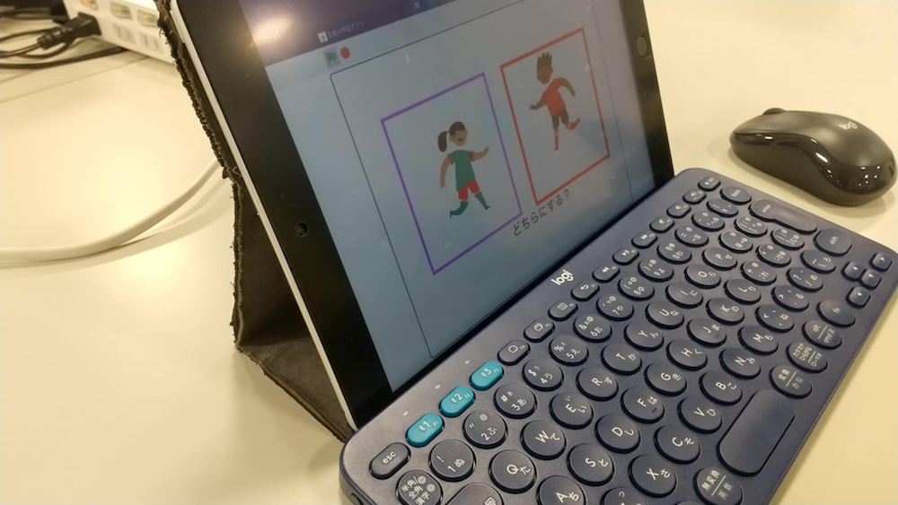
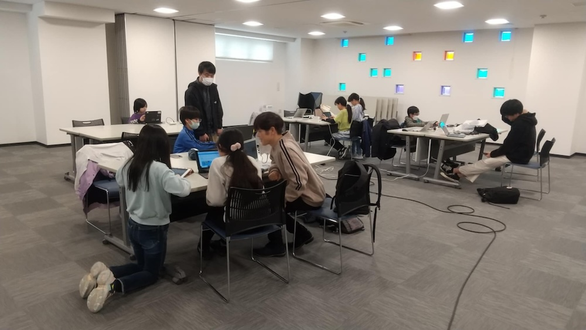
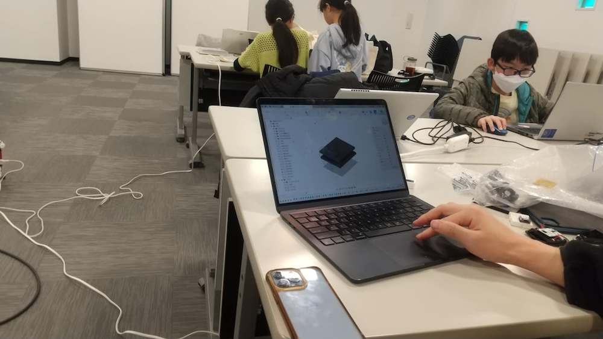
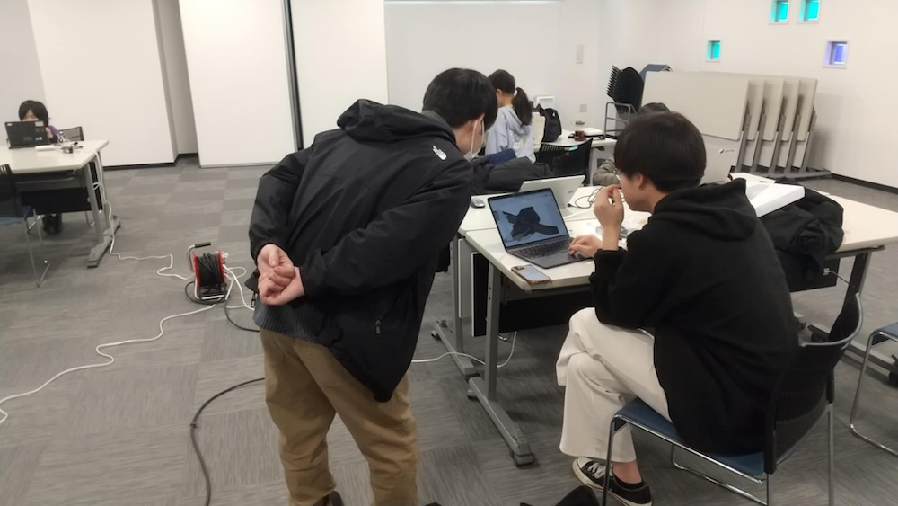
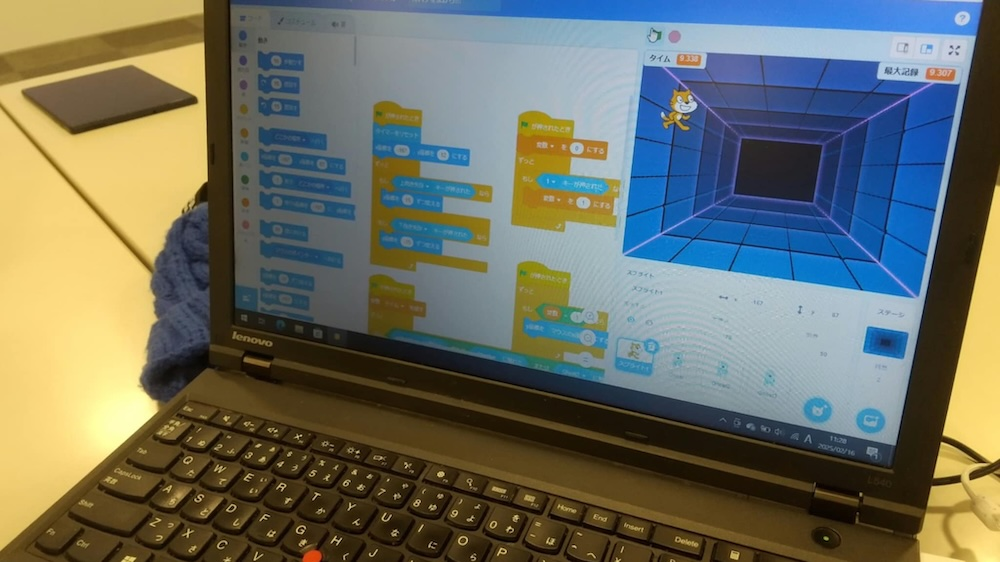
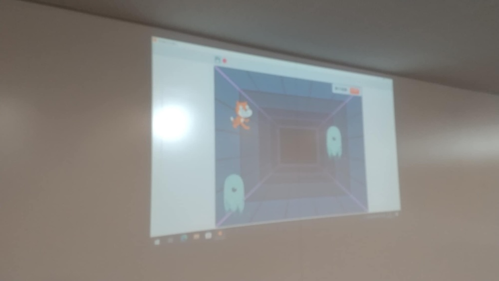
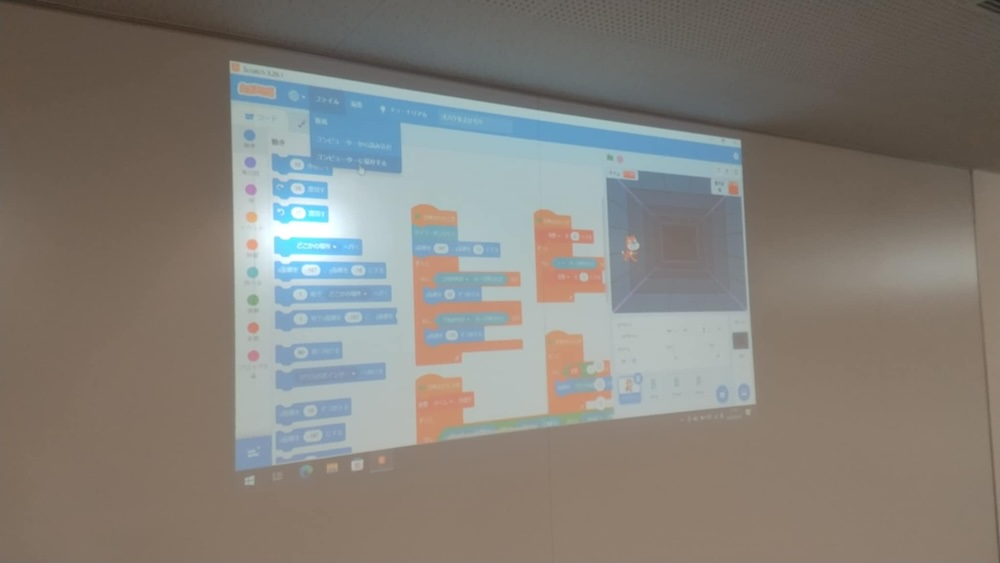
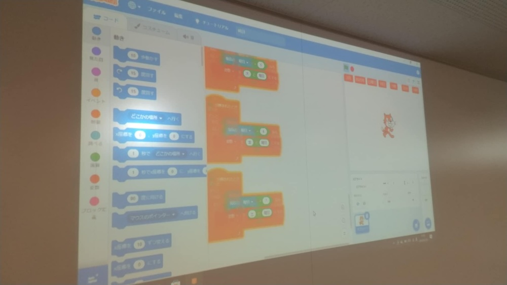
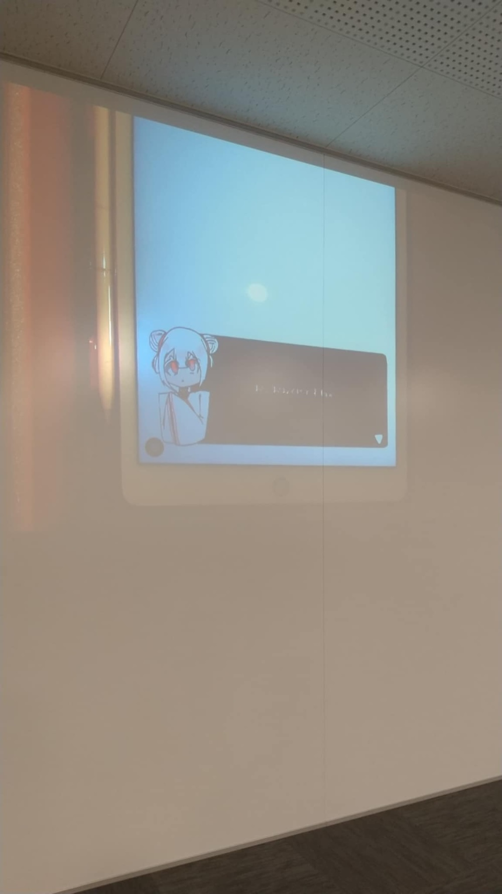

[子ども向けプログラミング道場：コーダー道場 82 回目 @大阪狭山](https://coderdojo-osakasayama.doorkeeper.jp/events/181797)

`2`名の **メンター** と`8`名の **ニンジャ** が集まりました。

会場は「[UP っぷ(子育て支援・世代間交流センター)](http://www.city.osakasayama.osaka.jp/kosodate_kyoiku/kosodate/upp_kosodatesiensedaikankouryuusenta1/index.html)」にて開催させていただきました。

## レポート 📝

### オープニング

### プログラミング

### 発表

### クロージング

