[子ども向けプログラミング道場：コーダー道場 83 回目 @大阪狭山](https://coderdojo-osakasayama.doorkeeper.jp/events/182673)

`2`名の **メンター** と`8`名の **ニンジャ** が集まりました。

会場は「[UP っぷ(子育て支援・世代間交流センター)](http://www.city.osakasayama.osaka.jp/kosodate_kyoiku/kosodate/upp_kosodatesiensedaikankouryuusenta1/index.html)」にて開催させていただきました。

## 当日のスケジュール ⏰

| 時間                   | 内容           |
| ---------------------- | -------------- |
| 9:30 - 9:40 (10 min)   | オープニング   |
| 9:40 - 10:50 (70 min)  | プログラミング |
| 10:50 - 11:00 (10 min) | 休憩           |
| 11:00 - 11:30 (30 min) | プログラミング |
| 11:30 - 11:50 (20 min) | 発表           |
| 11:50 - 12:00 (10 min) | クロージング   |

## レポート 📝

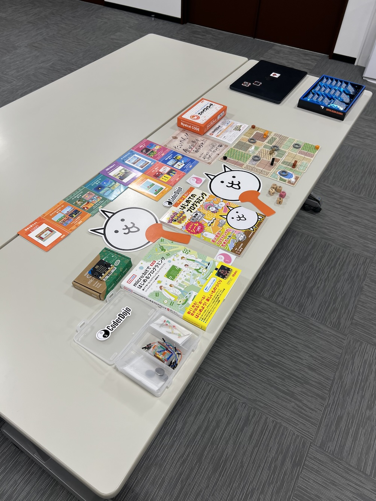

### オープニング

家族で一つの席にするタイルが定番になっています。

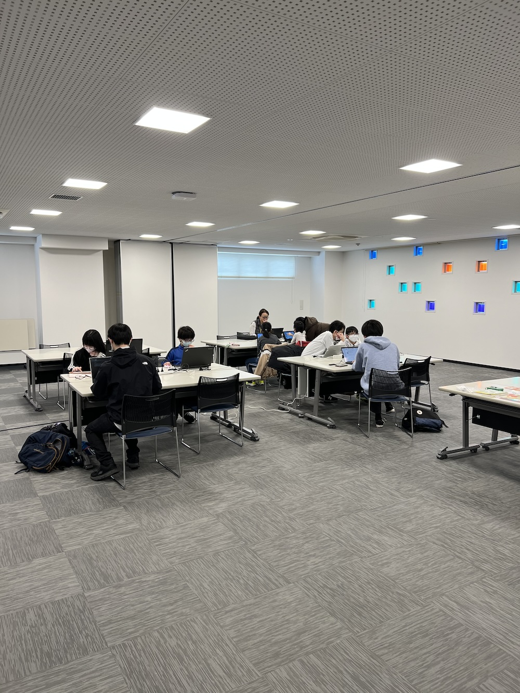

にゃんこ大戦争のプログラミング ドリルとニャイスコードを持ってきています。

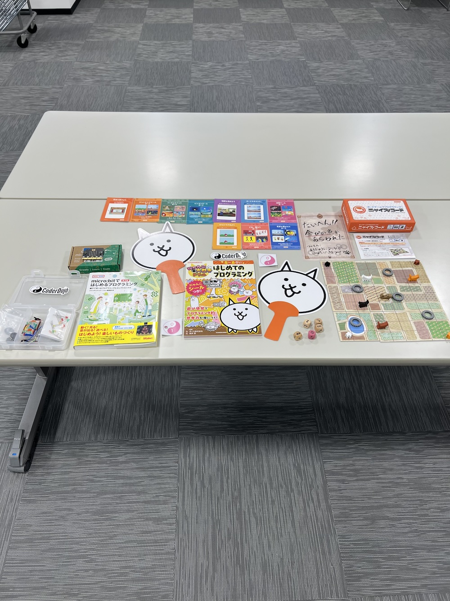

### プログラミング

プログラミングでポケモンをうごかしてみよう を開催しています。

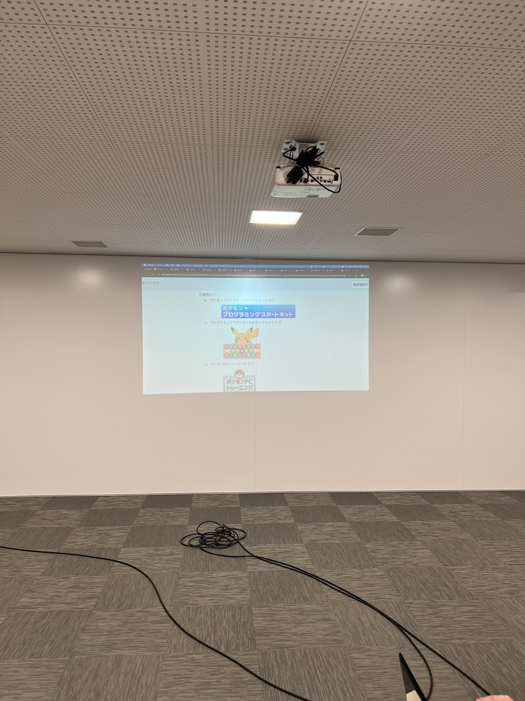

オンラインバージョンはすぐに利用ができて、スプライトや音が拡充されています。

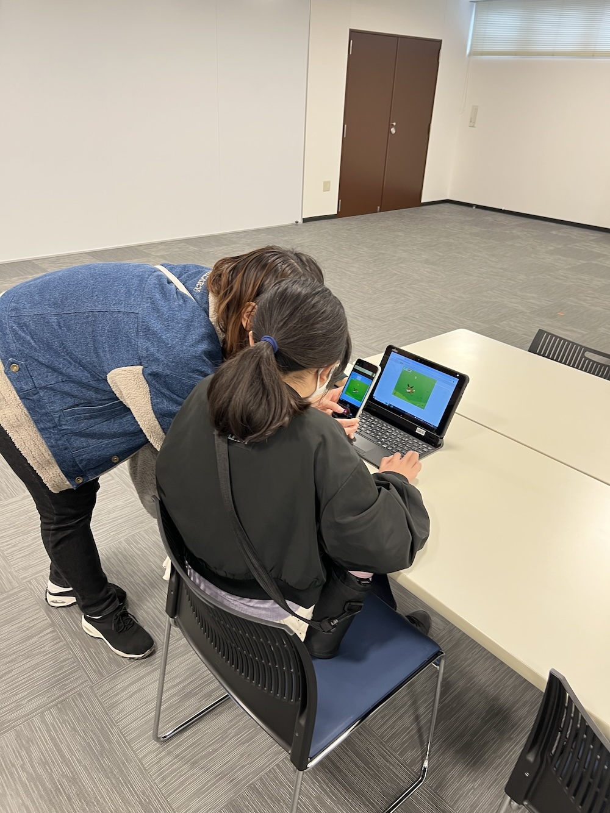

### 発表

#### 発表１

Scrach のアクションゲームです。

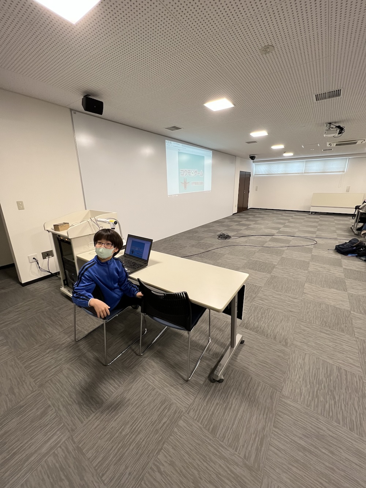

コウモリが障害物に当たらない様に進んでいきます。

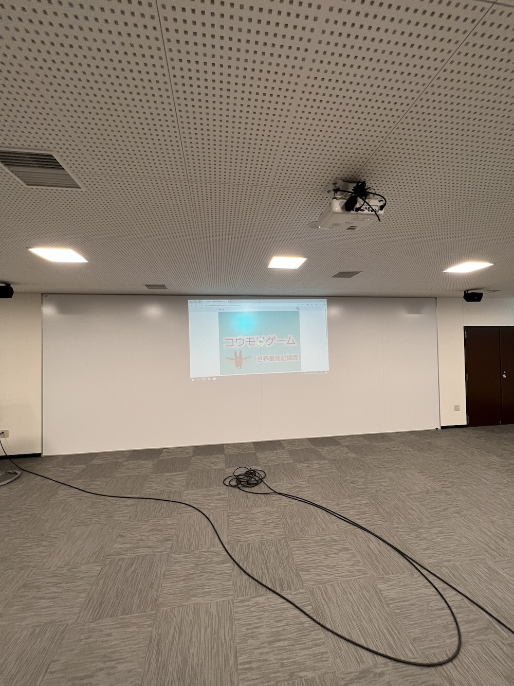

クラウド変数を使って、世界記録を保存して更新することができます。

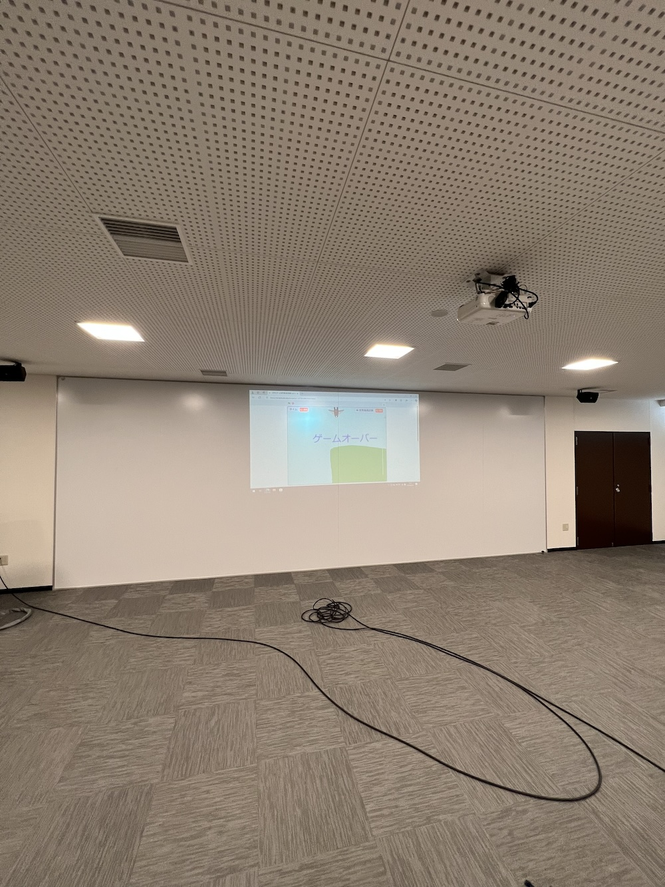

#### 発表２

Scrach のアドベンチャーゲームです。

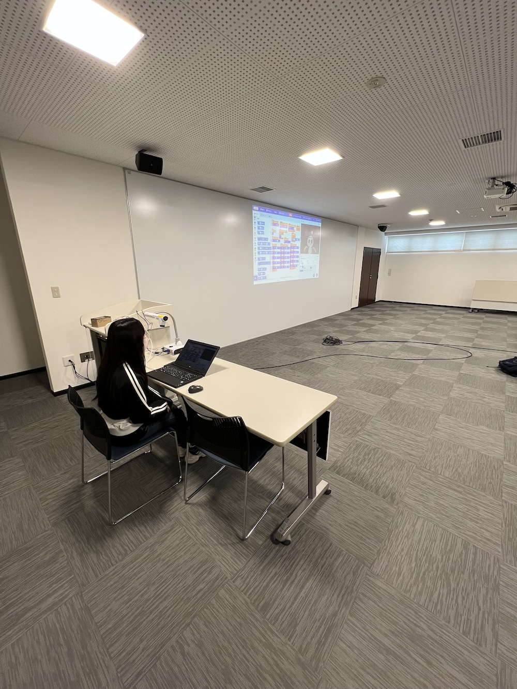

スプライトはアイビスベントで書いています。

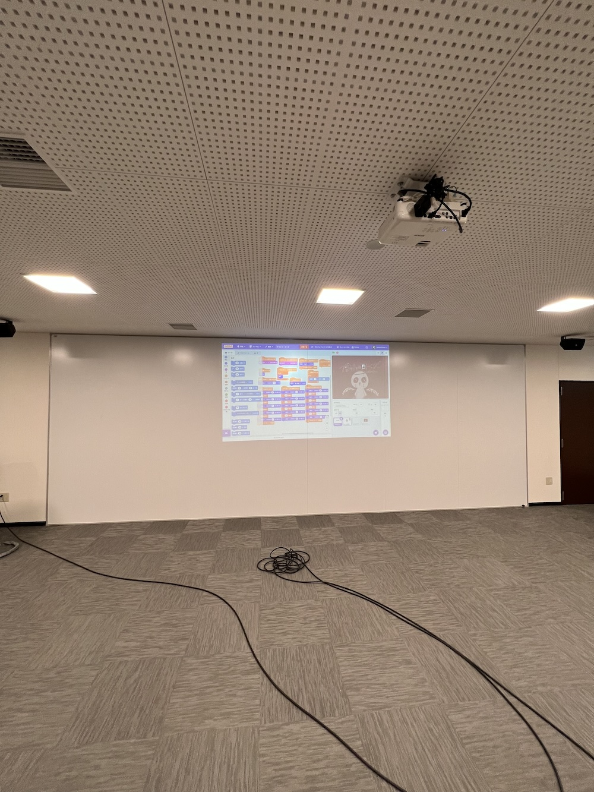

全ての会話をコスチュームで書いているので管理が大変そうです。

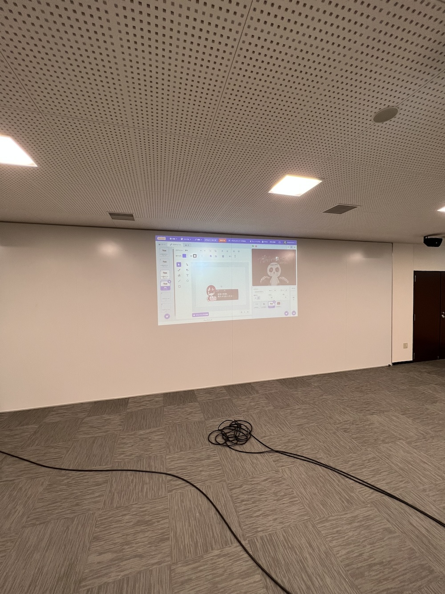

#### 発表３

Autodesk Fusion(Fusion 360) のモデリングです。

高校を卒業したので ニンジャ としては最後の発表です。

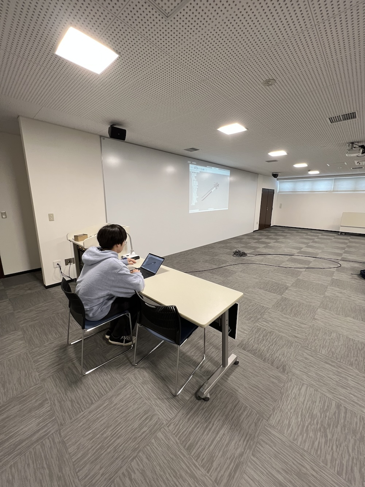

鞘から刀身を取り出すことができて、刀は柄から光ることができます。

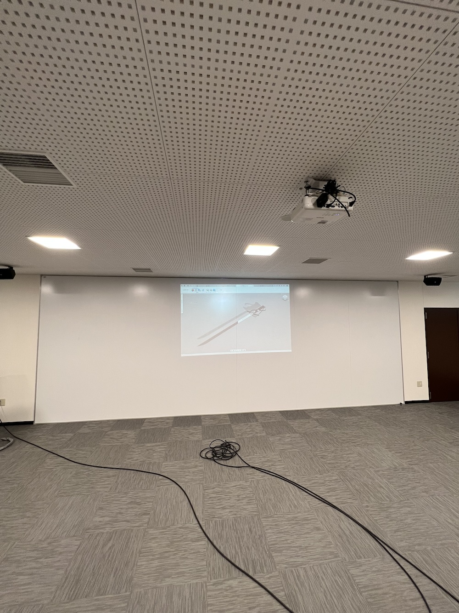

実物も完成しているようで、実際に光っているところが見たいです。

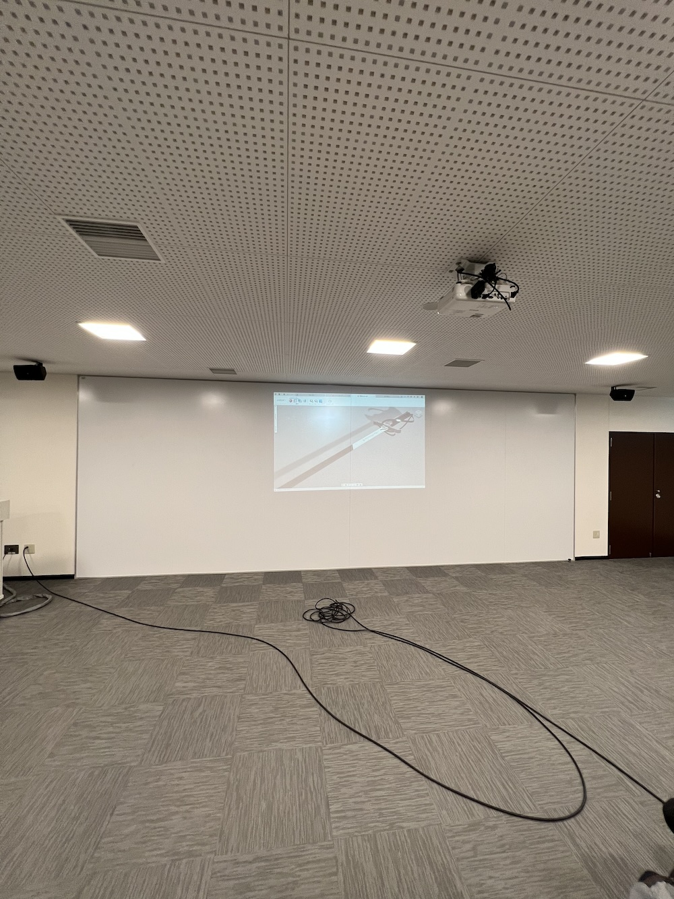

### クロージング

小学 4 年生から来てくれている子供は高校を卒業し、芸術の道を進むそうです。

CoderDojo が子供達の進路に影響してくれて嬉しく思います。

最後に 2016 年から続いた開催レポートですが、今回で終了いたします。

8 年間のご愛読ありがとうございました。
